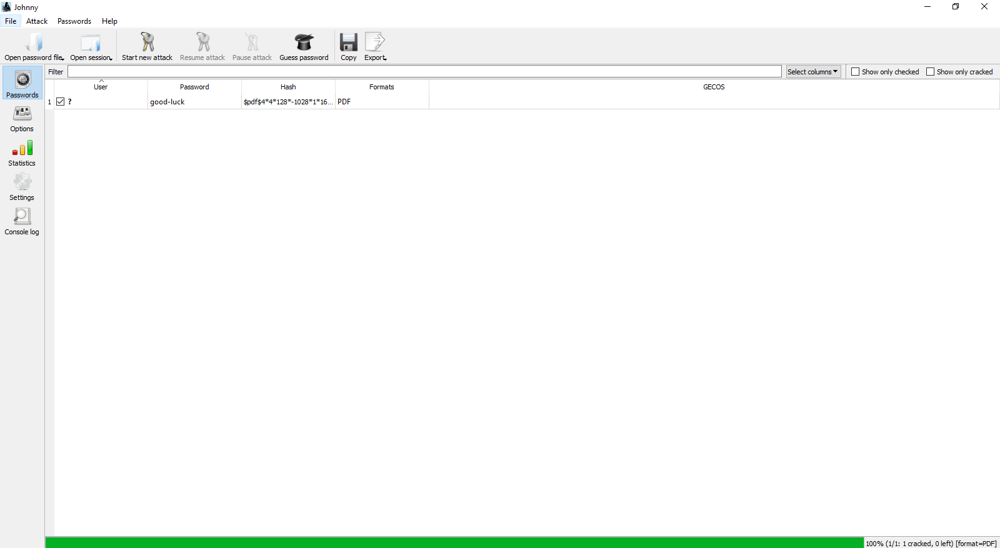
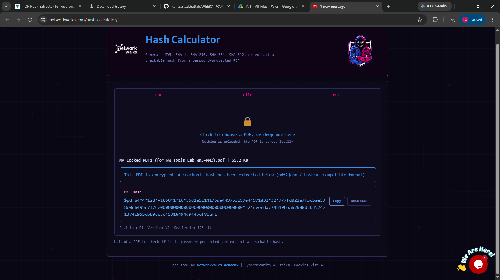
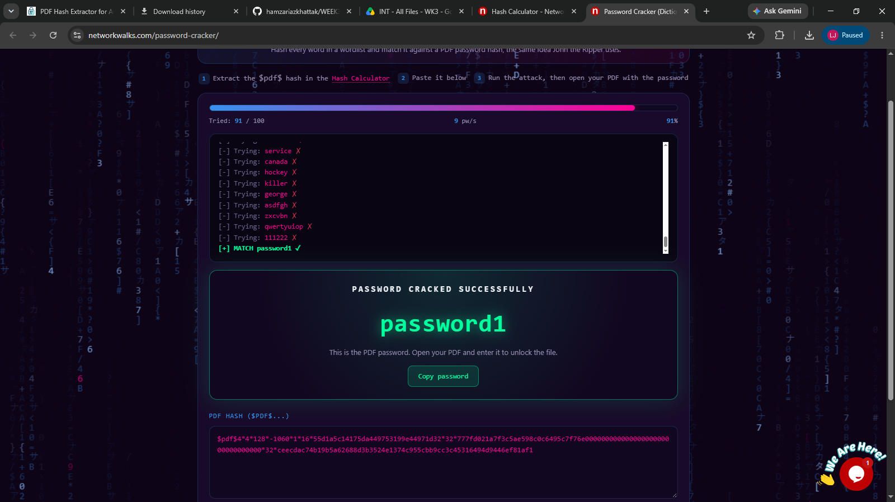

# NETWORKWALKS-B084G-WK3-JOHN-THE-RIPPER
cracking passowrds using hash text and passoword cracker
#  Password & Hash Cracking

Weekly cybersecurity training project. This week covered offline password cracking against a locked PDF and a hash-cracking exercise using a dedicated web tool.

## Tools Used
- **John the Ripper** (`john`) + **Johnny** (GUI front-end)
- **pdf Hash Extractor** (to extract a crackable hash from the PDF)
- **NetworkWalks Hash Caculator & Password Cracker**

---

## Task 1: Cracking a Password-Protected PDF (John / Johnny)

**Goal:** Recover the password on a locked PDF and extract the embedded flag.

**Steps:**
1. Extracted the PDF's hash using the link 
   https://www.onlinehashcrack.com/tools-pdf-hash-extractor.php
   
2. Loaded the hash into **Johnny** (GUI for John the Ripper) and ran a dictionary/brute-force attack.
3. Password cracked — opened the PDF and captured the flag.

**Evidence:**
> _ johnny view :.

> _flag1 capture :.

**Result:** PDF unlocked, Flag 1 captured ✅

---

## Task 2: NetworkWalks Hash Caculator & Password Cracker

**Goal:** Use the NetworkWalks online hash/password cracking tool to recover credentials from a given hash and capture the second flag.

**Steps:**
1. Submitted the provided hash to the NetworkWalks Hash & Password Cracker.
2. Identified the hash type and ran the crack.
3. Recovered plaintext password and captured the flag.

**Evidence:**
> _hash cracker:.

> _password:.
> _flag2 capture:
**Result:** Flag 2 captured ✅

---

## Key Takeaways
- How PDF encryption can be attacked offline once a crackable hash is extracted.
- Practical use of John the Ripper / Johnny for dictionary and brute-force attacks.
- Comparing a GUI-based local tool (Johnny) against an online hash-cracking service.

 **👤 Author**
## Lagundoye Juwon Akeem 

## LinkedIn: https://www.linkedin.com/in/lagundoye-juwon-4890b6244
## Cybersecurity Intern | Networkwalks | Batch B084

---
*Part of ongoing weekly cybersecurity training — see previous weeks in this repo's history.*
